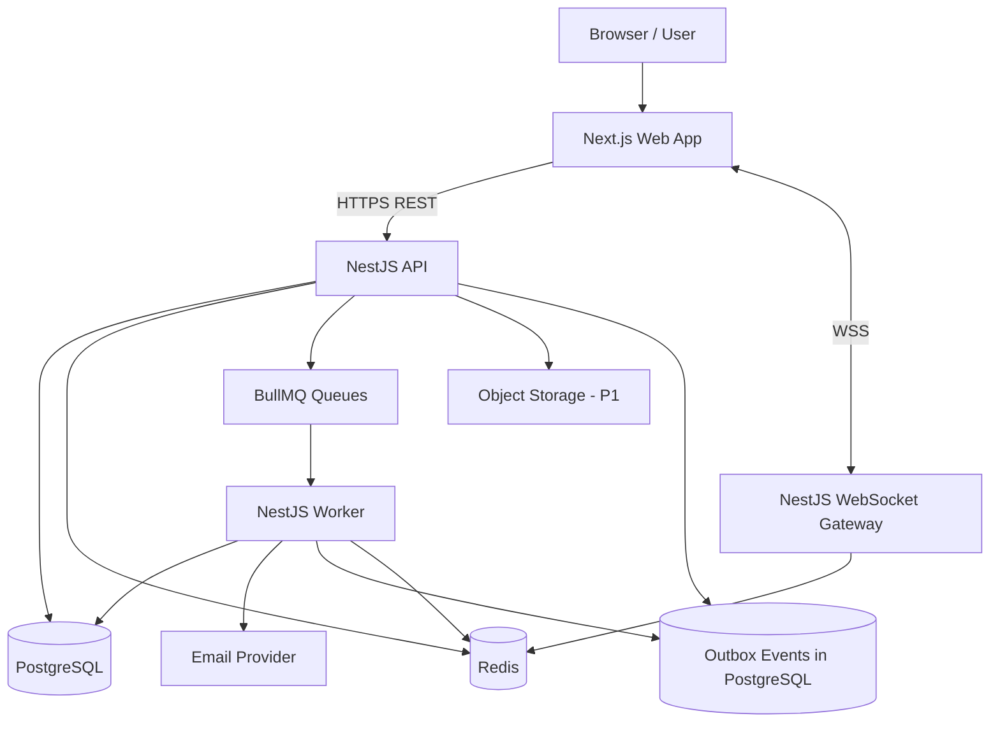
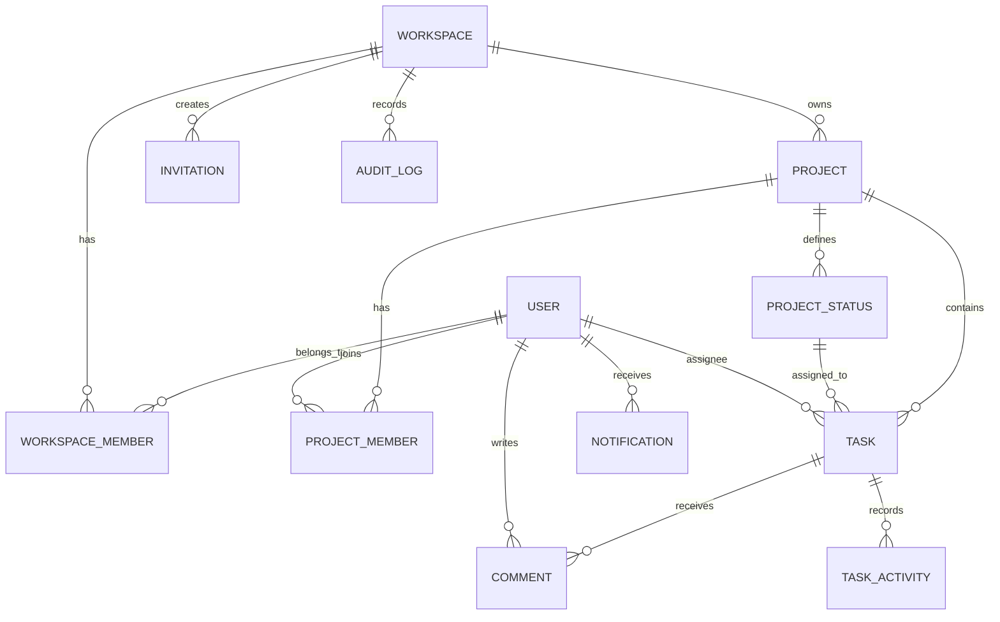

# Product Requirements Document (PRD)
# TaskFlow — Advanced Project Management SaaS

> **Dokumen acuan pengembangan produk (working title: TaskFlow)**  
> **Versi:** 1.0.0  
> **Status:** Draft — siap untuk technical planning  
> **Tanggal:** 20 November 2026  
> **Pemilik produk:** Portfolio / Solo Full-Stack Developer  
> **Stack utama:** Next.js (App Router), NestJS, TypeScript, PostgreSQL, Prisma, Redis, BullMQ  
> **Target:** Aplikasi SaaS multi-tenant yang dapat didemokan secara publik dan cukup matang untuk menunjukkan kompetensi full-stack advanced.

---

## 1. Ringkasan Eksekutif

**TaskFlow** adalah platform manajemen proyek dan kolaborasi tim berbasis SaaS (*Software as a Service*). Pengguna dapat membuat workspace organisasi, mengundang anggota, mengelola proyek, mengatur pekerjaan dengan Kanban/List/Calendar, bekerja secara real-time, dan memantau progres pekerjaan melalui laporan.

Berbeda dari aplikasi *to-do list* biasa, TaskFlow dirancang untuk menunjukkan masalah dunia nyata: isolasi data antar-organisasi, izin akses berlapis, konsistensi perubahan serentak, notifikasi asinkron, audit trail, dan kesiapan deployment.

**Value proposition:** "Satu tempat untuk merencanakan, menugaskan, dan memantau pekerjaan tim—aman untuk banyak organisasi, jelas untuk semua anggota."

**Strategi delivery:** bangun fondasi dan satu alur end-to-end yang stabil terlebih dahulu, lalu tambahkan kapabilitas SaaS advanced secara bertahap. Semua kemampuan yang ditandai sebagai *stretch* tidak boleh menghalangi deployment versi inti.

### 1.1 Definisi produk

| Atribut | Keputusan |
|---|---|
| Nama kerja | TaskFlow |
| Kategori | B2B SaaS / Project & Task Management |
| Platform utama | Responsive web application; desktop-first, mobile usable |
| Model tenant | Satu **workspace** mewakili satu tenant/organisasi |
| Model akses | Workspace role + project visibility/membership + resource authorization |
| Model backend | Modular monolith NestJS + worker asinkron |
| Database | Satu PostgreSQL bersama, isolasi data berbasis `workspace_id` |
| Peluncuran | Demo portfolio dengan seed data dan akun demo nonproduksi |
| Integrasi pembayaran | Tidak diwajibkan untuk peluncuran; modul entitlement/billing disiapkan secara opsional |

### 1.2 Prinsip produk

1. **Secure by default:** isolasi workspace dan authorization diuji pada setiap operasi.
2. **Fast to first value:** pengguna baru bisa membuat workspace dan task pertama secepat mungkin.
3. **Predictable collaboration:** pembaruan real-time tidak mengorbankan konsistensi data.
4. **Auditable:** perubahan penting dapat ditelusuri.
5. **Extensible:** fitur tambahan dibangun tanpa memaksa microservices sejak awal.
6. **Portfolio-first quality:** kualitas kode, test, dokumentasi, deployment, dan demonstrasi sama pentingnya dengan jumlah fitur.

---

## 2. Latar Belakang, Masalah, dan Peluang

### 2.1 Masalah pengguna

- Pekerjaan tersebar di chat, spreadsheet, dan catatan pribadi sehingga status sulit dilacak.
- Penugasan tidak jelas: siapa pemilik task, kapan tenggat, dan apa penghalangnya.
- Tim sulit mengetahui progres proyek secara menyeluruh.
- Informasi berubah tanpa riwayat keputusan atau perubahan yang mudah ditemukan.
- Organisasi membutuhkan pemisahan data, hak akses, dan undangan anggota yang aman.

### 2.2 Peluang produk

TaskFlow menyatukan alur kerja proyek dengan pengalaman pengguna modern dan fondasi SaaS yang layak dikembangkan. Untuk kebutuhan portofolio, produk juga menjadi bukti konkret atas kemampuan:

- Frontend: Next.js App Router, UI state kompleks, optimistic updates, accessibility.
- Backend: NestJS modular architecture, REST API, WebSocket, queues, authorization.
- Database: desain relasional, constraints, indexing, transaksi, migrasi.
- Infrastruktur: deployment, caching, observability, CI/CD, test automation.
- Rekayasa produk: prioritas scope, acceptance criteria, metrik, dan trade-off teknis.

### 2.3 Asumsi dan batasan

- Produk pertama adalah aplikasi web, bukan aplikasi native mobile.
- Bahasa UI MVP: Bahasa Inggris (i18n-ready); dokumentasi pengembangan boleh Bahasa Indonesia.
- Satu akun dapat menjadi anggota beberapa workspace.
- Isolasi tenant menggunakan database bersama; pemisahan database per tenant tidak masuk scope.
- Pengembangan dikerjakan oleh satu developer dengan waktu terbatas; estimasi harus dievaluasi ulang setelah spike teknis.
- Target performa dan keandalan dalam dokumen ini adalah **sasaran verifikasi**, bukan klaim sudah tercapai.

---

## 3. Tujuan Produk dan Indikator Keberhasilan

### 3.1 Tujuan bisnis/produk

| ID | Tujuan | Indikator keberhasilan awal |
|---|---|---|
| G-01 | Aktivasi pengguna baru | ≥ 80% tester dapat membuat workspace + proyek + task tanpa bantuan |
| G-02 | Kolaborasi tim | Undangan diterima dan task bisa ditugaskan lintas anggota |
| G-03 | Visibilitas pekerjaan | Status, prioritas, assignee, dan due date mudah ditemukan di dashboard |
| G-04 | Keamanan SaaS | Tidak ada akses antar-workspace dalam suite pengujian authorization |
| G-05 | Kualitas engineering | Build, lint, typecheck, dan critical-path tests lolos CI |
| G-06 | Kelayakan portofolio | Demo URL, API docs, dokumentasi arsitektur, dan akun demo tersedia |

> Persentase G-01 adalah target evaluasi internal dengan tester terbatas, bukan benchmark industri.

### 3.2 North-star dan metrik pendukung

**North-star (jika kelak digunakan secara nyata):** jumlah workspace aktif mingguan yang menyelesaikan setidaknya satu task.

Metrik pendukung:

- `workspace_created`, `project_created`, `task_created`, `task_completed`.
- `invitation_sent`, `invitation_accepted`.
- `weekly_active_workspaces`, `weekly_active_members`.
- Median waktu dari signup hingga task pertama.
- Rasio tugas dengan assignee dan due date.
- Persentase request API gagal, error rate, dan latency p95.

**Catatan privasi:** analytics produk menggunakan event minimal, tanpa menyimpan isi komentar atau data rahasia dalam telemetri.

### 3.3 Non-goals peluncuran awal

- Menjadi pengganti penuh Jira, Linear, Asana, atau ClickUp.
- Native Android/iOS, offline-first, AI assistant, video calls.
- Marketplace plugin/integrasi luas, workflow visual builder yang sangat fleksibel.
- Enterprise SSO/SAML/SCIM dan data residency per negara.
- Billing nyata sebelum pengujian fitur inti selesai.

---

## 4. Pengguna, Persona, dan Roles

### 4.1 Persona

| Persona | Kebutuhan | Masalah utama |
|---|---|---|
| Owner / Founder | Membuat workspace, mengelola anggota dan konfigurasi | Kehilangan kendali akses & progres tim |
| Project Manager | Memecah proyek menjadi task, menetapkan owner, mengecek hambatan | Sulit melihat status aktual |
| Team Member | Mengetahui task yang ditugaskan, memperbarui status, berdiskusi | Prioritas dan konteks pekerjaan tersebar |
| Guest / Client | Melihat atau memberi komentar pada proyek tertentu | Tidak perlu akses ke seluruh organisasi |
| Platform Operator | Memantau kesehatan sistem dan menangani penyalahgunaan | Menjaga operasi layanan tanpa mengintip data tenant |

### 4.2 Jenis role

**Workspace role:** `OWNER`, `ADMIN`, `MEMBER`, `GUEST`.

**Project role (opsional, dalam proyek yang diikuti):** `MANAGER`, `CONTRIBUTOR`, `VIEWER`.

Aturan dasar:

- `OWNER` adalah pemilik akhir workspace. Hanya owner boleh transfer ownership atau menghapus workspace.
- `ADMIN` mengatur project, anggota workspace, dan konfigurasi nonkepemilikan.
- `MEMBER` dapat membuat project sesuai kebijakan workspace dan berkolaborasi pada proyek yang dapat diaksesnya.
- `GUEST` hanya dapat melihat/berinteraksi pada proyek tempat ia diundang secara eksplisit.
- `MANAGER` adalah role **pada proyek**, bukan role global workspace.
- Platform operator hanya mendapat akses ke metadata operasional yang benar-benar diperlukan; tidak otomatis boleh membaca isi tenant.

### 4.3 Matriks permission (baseline)

| Aksi | Owner | Admin | Member | Guest |
|---|:---:|:---:|:---:|:---:|
| Ubah pengaturan workspace | ✅ | ✅* | ❌ | ❌ |
| Undang / keluarkan anggota | ✅ | ✅* | ❌ | ❌ |
| Transfer ownership / delete workspace | ✅ | ❌ | ❌ | ❌ |
| Membuat project | ✅ | ✅ | ✅* | ❌ |
| Melihat project WORKSPACE | ✅ | ✅ | ✅ | ❌ |
| Melihat project PRIVATE | ✅ | ✅† | ✅† | ✅† |
| Mengelola konfigurasi project | ✅ | ✅ | ✅† | ❌ |
| Membuat/mengubah task | ✅ | ✅ | ✅† | ✅† |
| Berkomentar | ✅ | ✅ | ✅† | ✅† |
| Melihat audit log workspace | ✅ | ✅ | ❌ | ❌ |
| Mengelola billing | ✅ | ✅* | ❌ | ❌ |

`*` Bergantung pada policy yang ditetapkan owner; kebijakan default didokumentasikan di kode.  
`†` Membutuhkan membership proyek dan/atau project permission yang tepat. Semua izin dinilai berdasarkan identitas user, workspace, visibilitas project, dan resource yang diminta—tidak cukup hanya memeriksa nama role.

**Keputusan keamanan:** data proyek privat tidak otomatis dapat dibaca oleh admin workspace. Hak admin untuk pengelolaan metadata atau pemulihan akses harus dirancang terpisah dan diaudit.

---

## 5. Ruang Lingkup dan Prioritas

### 5.1 Definisi prioritas

- **P0 — Core release:** minimum untuk produk SaaS yang berguna dan aman.
- **P1 — Advanced release:** membedakan aplikasi dari CRUD biasa, diprioritaskan setelah P0 stabil.
- **P2 — Stretch / SaaS commercialization:** ditambahkan jika P0 dan P1 sudah terverifikasi.
- **Out of scope:** secara eksplisit tidak dikerjakan pada siklus ini.

### 5.2 Feature inventory

| ID | Modul | Fitur | Prioritas |
|---|---|---|---|
| AUTH-01 | Identity | Register, login, logout, session refresh | P0 |
| AUTH-02 | Identity | Forgot/reset password, email verification | P1 |
| AUTH-03 | Identity | Session/device management, 2FA TOTP | P2 |
| WS-01 | Workspace | Buat, ubah, arsip workspace | P0 |
| WS-02 | Workspace | Switch workspace, membership multi-tenant | P0 |
| WS-03 | Workspace | Invite, accept, revoke, expiration | P0 |
| WS-04 | Workspace | Workspace roles, policy enforcement | P0 |
| PROJ-01 | Project | CRUD, archive, visibility | P0 |
| PROJ-02 | Project | Project membership/roles | P0 |
| PROJ-03 | Project | Custom task statuses & workflow | P1 |
| PROJ-04 | Project | Milestones, sprint/iteration | P1 |
| TASK-01 | Task | CRUD, identifier, status, priority, assignee | P0 |
| TASK-02 | Task | List & Kanban board; drag-and-drop | P0 |
| TASK-03 | Task | Search, filter, sort, pagination | P0 |
| TASK-04 | Task | Comments, activity history | P0 |
| TASK-05 | Task | Subtasks, labels, checklists, dependencies | P1 |
| TASK-06 | Task | File attachments via object storage | P1 |
| TASK-07 | Task | Recurring tasks, bulk actions, templates | P2 |
| VIEW-01 | Views | Personal My Tasks, Today/Upcoming | P0 |
| VIEW-02 | Views | Calendar and timeline views | P1 |
| COLLAB-01 | Collaboration | Realtime task/board updates | P1 |
| COLLAB-02 | Collaboration | Presence and typing indicator | P2 |
| NOTIF-01 | Notifications | In-app notifications & read state | P1 |
| NOTIF-02 | Notifications | Email notifications & preferences | P1 |
| REPORT-01 | Reporting | Project summary, task counts, overdue | P0 |
| REPORT-02 | Reporting | Workload, cycle time, sprint reports | P1 |
| TIME-01 | Time tracking | Manual tracked time entries | P1 |
| AUDIT-01 | Security | Append-only audit events for sensitive actions | P0 |
| SEARCH-01 | Search | Workspace-wide full-text search | P1 |
| AUTO-01 | Automations | Rule-based trigger/action engine | P2 |
| BILL-01 | SaaS | Plan entitlements & quotas | P2 |
| BILL-02 | SaaS | Payment provider, subscriptions, webhooks | P2 |
| INT-01 | Integrations | Outbound webhooks/public API tokens | P2 |
| ADMIN-01 | Operations | Health checks, metrics, logging | P0 |

### 5.3 Aturan prioritisasi

P0 adalah **release gate**. P1 baru dikerjakan jika isolasi data, RBAC, CRUD, dan deployment sudah lolos pengujian. Setiap fitur P1/P2 harus memiliki owner teknis, acceptance criteria, serta rollback plan sederhana sebelum mulai.

---

## 6. Kebutuhan Fungsional — Detail

Di setiap modul, kriteria penerimaan menjadi kondisi yang dapat diuji oleh developer/QA.

### 6.1 Authentication & account management (`AUTH`)

**FR-AUTH-01 — Registrasi akun**

- User dapat membuat akun dengan `name`, `email`, `password`.
- Email dinormalisasi (misalnya lowercase) dan unik setelah normalisasi.
- Password disimpan menggunakan algoritma hashing adaptif (misalnya Argon2id), bukan plaintext.
- Sistem memberikan pesan kesalahan validasi yang jelas, tanpa membocorkan keberadaan akun secara tidak perlu pada alur sensitif.
- Untuk demo dapat disediakan seed akun tanpa membuka jalur bypass keamanan di production.

**Acceptance criteria:**

1. Email valid dan password memenuhi policy → user baru berhasil dibuat.
2. Email yang sudah terdaftar → respons gagal terkontrol; tidak membuat akun duplikat.
3. Password tidak pernah muncul pada response API, log, atau database dalam plaintext.

**FR-AUTH-02 — Login dan manajemen sesi**

- Login dengan email dan password.
- Implementasi access/refresh session dengan cookie `HttpOnly`, `Secure` (production), `SameSite` yang sesuai, serta rotasi refresh token.
- Logout menginvalidasi refresh session; token yang dicabut tidak dapat digunakan kembali.
- Proteksi brute force (rate limit / progressive protection) pada endpoint auth.
- Semua mutasi dengan autentikasi cookie memiliki perlindungan CSRF yang sesuai dengan topologi deployment.

**Acceptance criteria:**

1. Akun valid dapat login dan mengakses `/me`.
2. Sesi tidak valid/expired ditolak dengan `401`.
3. Pengguna yang sudah logout tidak bisa memperbarui sesi dengan token lama.
4. Cookie sensitif tidak dapat dibaca dari JavaScript browser.

**FR-AUTH-03 — Akun & profil**

- User dapat mengubah nama, avatar, timezone, dan preferensi dasar.
- User dapat memiliki banyak workspace, tanpa membuat akun baru.
- Reset password memakai token sekali pakai, memiliki TTL, dan tidak diekspos lewat log.

### 6.2 Workspaces & invitations (`WS`)

**FR-WS-01 — Buat workspace**

- User yang login dapat membuat workspace dengan nama dan slug unik global.
- Pembuat otomatis menjadi `OWNER`.
- Workspace tersimpan dengan timezone default dan konfigurasi dasar.
- Seluruh data turunan selalu memiliki scope tenant yang jelas.

**Acceptance criteria:**

1. Setelah membuat workspace, owner terdaftar tepat satu kali.
2. Slug unik; konflik slug mengembalikan `409 Conflict`.
3. User dapat berpindah antar-workspace miliknya tanpa melihat data workspace lain.

**FR-WS-02 — Undangan anggota**

- Owner/admin dapat mengundang anggota melalui email dan menentukan workspace role.
- Invitation memiliki token acak yang disimpan sebagai hash, masa kedaluwarsa, status, dan pengundang.
- Invitation dapat dibatalkan atau dikirim ulang dengan token baru.
- Undangan untuk email yang sudah terdaftar tetap memerlukan konfirmasi dari pemilik akun tersebut.
- Penerimaan invitation wajib memverifikasi identitas email penerima; jangan menambahkan sesi yang tidak cocok hanya karena mengetahui tautan.

**Acceptance criteria:**

1. Invitation valid dan pemilik email cocok → membership dibuat satu kali.
2. Invitation expired/revoked/used → tidak dapat digunakan.
3. Dua request penerimaan simultan tidak menghasilkan membership ganda.
4. Admin tidak dapat mengundang user dengan role `OWNER`.

**FR-WS-03 — Kelola anggota**

- Owner/admin dapat menampilkan anggota, mengubah role yang diizinkan, atau mengeluarkan anggota.
- Owner terakhir tidak boleh dikeluarkan/didemote tanpa proses transfer ownership.
- Mengeluarkan anggota menghapus akses ke resource yang bergantung pada membership (realtime session harus ditinjau/di-revoke).

### 6.3 Projects & project access (`PROJ`)

**FR-PROJ-01 — CRUD dan lifecycle proyek**

- Project memiliki `name`, `key` (mis. `MKT`), `description`, `visibility`, `status`, `startDate`, `dueDate`, dan `workspaceId`.
- `key` unik per workspace dan tidak boleh diubah jika sudah dipakai sebagai identifier task, kecuali ada mekanisme migrasi khusus.
- Visibility `WORKSPACE` atau `PRIVATE`.
- Hanya user dengan izin yang sesuai dapat melihat atau mengubah proyek.
- Arsip menyembunyikan proyek dari daftar default tanpa menghapus histori.

**Acceptance criteria:**

1. Dua project dalam satu workspace tidak dapat memakai key sama.
2. Private project tidak dapat dibaca oleh anggota workspace yang bukan project member.
3. Member yang dikeluarkan dari private project kehilangan akses ke task dan attachment terkait.

**FR-PROJ-02 — Project membership**

- Project manager dapat menambahkan anggota workspace atau guest terotorisasi ke proyek.
- Project role menentukan kemampuan mengatur task dan konfigurasi proyek.
- User hanya boleh menerima project role jika memiliki workspace membership yang valid.

**FR-PROJ-03 — Workflow custom (P1)**

- Manager dapat mengelola status proyek (nama, kategori, urutan tampilan, warna).
- Setiap status termasuk kategori logis: `BACKLOG`, `TODO`, `IN_PROGRESS`, `DONE`, `CANCELED`.
- Saat status digunakan oleh task, penghapusan status mewajibkan mapping ke status pengganti.
- Perubahan konfigurasi tercatat di audit log.

### 6.4 Tasks (`TASK`)

**FR-TASK-01 — Struktur task**

Field minimal:

- `id` (UUID/CUID), `workspaceId`, `projectId`, `number`, `key` turunan (mis. `MKT-104`).
- `title`, `description` (rich text aman), `statusId`/status, `priority`.
- `reporterId`, `assigneeId` (nullable), `startDate`, `dueDate`.
- `position` untuk urutan Kanban/List, `version` untuk optimistic concurrency.
- `createdAt`, `updatedAt`, `completedAt`, `archivedAt`.

**Business rules:**

1. `number` meningkat unik per project di dalam transaksi atomik; identitas `projectKey-number` tidak boleh berbenturan.
2. Assignee harus user yang berhak mengakses project.
3. `dueDate` tidak boleh sebelum `startDate` jika keduanya terisi.
4. Task pada project yang diarsipkan tidak boleh dimutasi oleh member biasa.
5. Perubahan status ke kategori `DONE` mengisi `completedAt`; kembali ke status aktif mengosongkan atau mencatat transisi sesuai kebijakan historis.
6. Konten description/comment harus disanitasi saat render untuk mencegah XSS.

**Acceptance criteria:**

- Dua request pembuatan task bersamaan menghasilkan nomor unik tanpa kehilangan task.
- User tidak bisa assign task kepada user dari workspace lain.
- Status berubah di database dan konsisten setelah refresh.
- Semua task mutasi menegakkan authorization pada project yang sebenarnya.

**FR-TASK-02 — List & Kanban board**

- Board menampilkan kolom berdasarkan status; task card berisi key, title, priority, assignee, due date.
- Drag-and-drop dapat memindahkan task antar status dan mengubah urutan dalam kolom.
- UI menggunakan optimistic update, tetapi rollback jika backend menolak.
- Penyimpanan urutan mendukung perubahan bersamaan (version check atau strategi order-key yang aman, disertai mekanisme refresh).
- Board menyediakan empty/loading/error states yang bermakna.

**Acceptance criteria:**

1. Drag task ke kolom baru → status tersimpan.
2. Permission tidak valid → mutasi ditolak dan UI kembali ke state server.
3. Dua client mengubah task yang sama → konflik dikelola tanpa silent overwrite (mis. `409`, re-fetch, pemberitahuan).
4. Board tetap usable lewat keyboard untuk interaksi penting.

**FR-TASK-03 — Filter, sort, dan search**

- Filter berdasarkan status, priority, assignee, label, due date.
- Pencarian title/key minimal di dalam project (P0); search lintas-workspace (P1).
- API pagination berbasis cursor untuk daftar berskala besar; batas page size ditetapkan.
- Filter bisa dibagikan melalui URL query parameters.

**FR-TASK-04 — Comment & activity**

- Pengguna yang berhak dapat membuat komentar, mengedit komentar miliknya (dengan batasan), dan menghapus secara soft delete jika diperlukan.
- Riwayat perubahan task memuat actor, aksi, timestamp, ringkasan perubahan (tanpa secret).
- Komentar dan activity diurutkan secara deterministik berdasarkan waktu dan ID.
- Edit dan delete dilakukan sesuai izin dan diaudit untuk aksi sensitif.

**FR-TASK-05 — Subtasks/dependencies/checklists (P1)**

- Subtask tidak boleh membentuk siklus parent-child.
- Dependency menggunakan jenis minimal `BLOCKS` dan `RELATES_TO`; `BLOCKS` tidak boleh membentuk siklus.
- Task yang masih blocked ditandai di UI; kebijakan mencegah/menyarankan completion diatur eksplisit.
- Checklist memiliki urutan, status selesai, dan pembuat.

**FR-TASK-06 — Attachments (P1)**

- File diunggah ke object storage lewat signed URL / upload proxy yang aman.
- Metadata file disimpan di database dengan `workspaceId`, `taskId`, `uploaderId`, `objectKey`, `size`, `mimeType`.
- Terapkan limit ukuran, tipe file yang diperbolehkan, scanning bila tersedia, dan signed download URL singkat.
- Tidak boleh mengizinkan akses langsung ke objek tenant lain.

### 6.5 Views & dashboard (`VIEW`, `REPORT`)

**FR-VIEW-01 — My Tasks**

- Menampilkan task yang ditugaskan kepada user dari seluruh workspace yang ia ikuti, dengan pemisahan visual workspace dan project.
- Filter `Assigned`, `Due Soon`, `Overdue`, `Completed`.
- Navigasi menuju halaman task detail dengan permission check ulang.

**FR-REPORT-01 — Dashboard ringkasan (P0)**

- Project dashboard menampilkan jumlah task by status, task overdue, total completed, dan recent activity.
- Perhitungan memfilter data hanya dari project yang dapat diakses pengguna.
- Data kosong tidak menghasilkan pembagian nol atau grafik menyesatkan.

**FR-REPORT-02 — Advanced analytics (P1)**

- Cycle time, throughput mingguan, completion rate, dan workload per assignee.
- Semua definisi metrik ditulis di UI/tooltip dan diuji terhadap dataset seed.
- Data chart diambil dari endpoint agregasi yang mempertimbangkan akses dan skala data.

**FR-VIEW-02 — Calendar/timeline (P1)**

- Tampilkan task berdasarkan due date/start date dengan timezone user.
- Timeline menampilkan milestone, dependencies, dan tanggal proyek jika datanya tersedia.
- Perubahan tanggal dengan drag-and-drop opsional, tunduk pada authorization.

### 6.6 Real-time collaboration (`COLLAB`, P1)

**FR-COLLAB-01 — Live updates**

- Client yang sedang berada di project menerima informasi perubahan task, komentar, assignee, dan status secara real-time.
- WebSocket room scoped ke workspace/project yang sah; room join memerlukan validasi session dan membership.
- Event direpresentasikan sebagai notifikasi perubahan, bukan sumber kebenaran utama; client melakukan invalidate/re-fetch bila diperlukan.
- Event memiliki `eventId`, `workspaceId`, `resourceId`, `version`, dan timestamp.
- Jika koneksi terputus, client re-fetch state server saat reconnect.
- Operasi database tetap bekerja walau WebSocket server sementara tidak tersedia.

**Acceptance criteria:**

1. Dua anggota project melihat perubahan task tanpa refresh manual dalam kondisi jaringan normal.
2. Anggota workspace lain tidak dapat subscribe pada project yang bukan haknya.
3. Event duplikat tidak menghasilkan task card ganda.
4. Reconnect menghasilkan state terbaru melalui re-sync, bukan bergantung pada event yang terlewat.

**FR-COLLAB-02 — Presence (P2)**

- Tampilkan siapa yang online/melihat task, dengan TTL dan tanpa mengekspos aktivitas antar-tenant.
- Presence bukan indikator absolut apakah user sedang bekerja; matikan jika menimbulkan masalah privasi.

### 6.7 Notifications (`NOTIF`, P1)

**FR-NOTIF-01 — In-app notification**

Pemicu minimal:

- Task di-assign ke user.
- User di-mention pada komentar (jika mention P1 diaktifkan).
- Status task yang diikuti berubah.
- Undangan workspace/project diterima atau kedaluwarsa (sesuai relevansi).

Aturan:

- Notification memiliki penerima, actor, type, resource reference, unread state, timestamp.
- Jangan membuat notifikasi untuk actor yang sama kecuali ada kebijakan khusus.
- Recipient harus punya hak membaca resource saat membuka tautan notifikasi.
- Task mutasi tidak bergantung pada berhasil/tidaknya kirim email.

**FR-NOTIF-02 — Email delivery**

- Job email dikirim melalui BullMQ worker.
- Retry dengan exponential backoff, dead-letter/failure observability, dan deduplication key.
- User dapat mengatur preferensi kanal email/in-app.
- Email hanya mengandung informasi minimal bila akses atau keanggotaan telah berubah.

### 6.8 Audit log (`AUDIT`)

**FR-AUDIT-01 — Audit actions**

Catat minimal:

- Login sensitif / perubahan password (metadata seperlunya).
- Invitation dibuat, dibatalkan, diterima.
- Role anggota berubah; anggota dikeluarkan.
- Workspace dan project dibuat/dihapus/diarsipkan.
- Perubahan visibility project, transfer ownership.
- Perubahan status penting/task assignment (bisa juga berada di activity event terpisah).

Field audit minimal: `id`, `workspaceId` (nullable untuk peristiwa akun), `actorId`, `action`, `targetType`, `targetId`, `timestamp`, `metadataSanitized`, `requestId`.

**Aturan:** append-only di level aplikasi; perubahan/penghapusan hanya lewat kebijakan retensi administratif yang terdokumentasi. Jangan simpan password, token, isi file, atau header sensitif.

### 6.9 Advanced automations (`AUTO`, P2)

- Aturan sederhana berupa trigger + kondisi + aksi, misalnya:
  - `When task status becomes DONE → notify project manager`.
  - `When due date is within 24h → send reminder`.
  - `When task created with priority URGENT → assign default reviewer`.
- Aturan hanya dapat dibuat oleh pihak yang berhak dan selalu dieksekusi dalam scope tenant.
- Setiap eksekusi mempunyai idempotency key, max depth/loop protection, rate limit, dan execution log.
- Tidak menerima/mengeksekusi JavaScript arbitrer dari pengguna.

### 6.10 SaaS plans, billing & webhooks (`BILL`, `INT`, P2)

- Plan contoh: `FREE`, `PRO`, `BUSINESS`.
- Entitlements berbasis server-side rules: maximum members, projects, file quota, automations.
- Upgrade/downgrade dan status subscription dimodelkan tanpa mengunci aplikasi pada satu payment provider.
- Jika billing nyata diimplementasikan, provider dipilih setelah mempertimbangkan wilayah, legalitas, dan kebutuhan merchant.
- Payment webhook wajib memvalidasi signature, event idempotency, state transition, dan replay protection.
- Public API tokens di-hash saat disimpan, dapat dicabut, dan dibatasi scope + rate limits.

> **Penting:** Untuk portfolio, billing sandbox + entitlement yang benar sudah cukup. Jangan mewajibkan pembayaran sungguhan agar recruiter dapat mencoba demo.

---

## 7. User Journeys & Acceptance Scenarios

### 7.1 Onboarding workspace pertama

1. Visitor membuka landing page.
2. Visitor register/login.
3. User diarahkan ke wizard `Create Workspace`.
4. User memasukkan nama workspace; slug dibuat otomatis dan dapat disunting.
5. Sistem membuat workspace beserta owner membership dalam satu transaksi.
6. User membuat project pertama dan task pertama.
7. Dashboard menampilkan progres proyek.

**Exit criteria:** pengguna berhasil mencapai task pertama tanpa bantuan.

### 7.2 Kolaborasi beberapa anggota

1. Owner mengirim invitation ke email anggota.
2. Penerima sign in/sign up dengan email yang sesuai.
3. Penerima menerima invitation sebelum expired.
4. Owner/project manager menambahkan anggota ke project PRIVATE bila perlu.
5. Manager membuat task dan mengassign ke anggota.
6. Anggota melihat task di My Tasks dan memindahkan status.
7. Manager melihat perubahan di Kanban dan activity log.

### 7.3 Skenario keamanan lintas tenant

**Given** user A anggota workspace Alpha dan bukan anggota workspace Beta.  
**When** user A meminta `GET /api/v1/workspaces/{betaId}/projects`.  
**Then** API menolak akses tanpa mengembalikan daftar proyek Beta.  
**And** tidak ada metadata tenant sensitif yang bocor melalui error.

### 7.4 Skenario optimistic concurrency

**Given** dua anggota membuka detail task versi 12.  
**When** anggota pertama menyimpan perubahan dan versi naik menjadi 13.  
**And** anggota kedua mengirim perubahan berbasis versi 12.  
**Then** server merespons `409 Conflict` atau kebijakan merge yang terdokumentasi.  
**And** frontend memberi opsi refresh/retry, bukan diam-diam menimpa data anggota pertama.

### 7.5 Undangan dua kali bersamaan

**Given** invitation belum diterima.  
**When** dua request penerimaan dikirim hampir bersamaan.  
**Then** database hanya memiliki satu workspace membership dan invitation berstatus accepted satu kali.

### 7.6 Perubahan realtime

**Given** dua anggota membuka Kanban proyek yang sama.  
**When** anggota pertama memindahkan task dari TODO ke IN_PROGRESS.  
**Then** anggota kedua melihat state baru dalam target latency yang ditetapkan.  
**And** refresh halaman menampilkan state sama dengan database.

---

## 8. Information Architecture & UI/UX

### 8.1 Sitemap utama

```text
/
├── /login
├── /register
├── /forgot-password
├── /onboarding/workspace
└── /app
    ├── /my-tasks
    ├── /notifications
    └── /w/[workspaceSlug]
        ├── /overview
        ├── /projects
        ├── /projects/[projectKey]/overview
        ├── /projects/[projectKey]/board
        ├── /projects/[projectKey]/list
        ├── /projects/[projectKey]/calendar          [P1]
        ├── /projects/[projectKey]/settings
        ├── /tasks/[taskKey]
        ├── /reports                             [P1]
        ├── /members
        ├── /invitations
        ├── /audit-log
        └── /settings
```

### 8.2 Komponen UI utama

- **App shell:** sidebar workspace/project, topbar, workspace switcher, user menu.
- **Workspace overview:** welcome panel, recent projects, task summary, activity stream.
- **Project board:** Kanban columns, draggable task cards, task quick-create.
- **Task detail:** title, rich description, status/priority/assignee, comment feed, activity history.
- **Project list:** table dengan pagination, filter, sort, bulk selection (P2).
- **Member management:** tabel anggota, role dropdown, invitation modal, revoke action.
- **Notifications center:** unread count, mark as read, link ke target resource.
- **Settings:** workspace metadata, policies, project visibility, integrations (P2).

### 8.3 UI states wajib

Setiap halaman kritis wajib memiliki:

1. Loading/skeleton state.
2. Empty state dengan next action.
3. Error state + retry.
4. Unauthorized/forbidden state tanpa kebocoran data.
5. Confirmation dialog pada destructive actions.
6. Optimistic state/rollback jika user berinteraksi cepat.
7. Responsive layout minimal pada ukuran ponsel umum.

### 8.4 Pedoman UX/accessibility

- Navigasi utama dapat diakses keyboard dan memiliki focus indicator.
- Input dan icon buttons mempunyai label yang bermakna.
- Jangan hanya menggunakan warna untuk membedakan status/priority.
- Modal mengelola focus trap dan escape behavior dengan benar.
- Form menampilkan error di field terkait; pengumuman untuk screen reader bila relevan.
- Target WCAG 2.2 AA untuk alur utama; lakukan pemeriksaan otomatis dan manual.
- Konfirmasi untuk irreversible actions, toast untuk sukses nonkritikal.

### 8.5 Design system

Gunakan shadcn/ui sebagai dasar komponen, Tailwind CSS untuk tokens, ikon konsisten, dark/light theme, serta komponen domain yang reusable (`TaskCard`, `TaskStatusBadge`, `MemberAvatar`, `ProjectSwitcher`).

---

## 9. Arsitektur Teknis

### 9.1 Diagram konteks



Diagram menunjukkan komponen logis. Di tahap awal, API, WebSocket gateway, dan worker boleh berjalan dalam satu deployment dengan pemisahan proses yang dapat dikembangkan kemudian.

### 9.2 Architecture decisions (ADR ringkas)

| Keputusan | Pilihan | Alasan | Trade-off |
|---|---|---|---|
| A-01 | Modular monolith | Lebih cepat dibangun dan diuji sebagai solo developer | Scaling tidak segranular microservices |
| A-02 | PostgreSQL shared database | Efisien dan memudahkan transaksi relasional | Tenant scoping harus sangat disiplin |
| A-03 | Prisma ORM | Typed queries, migrations, developer productivity | Beberapa constraint kompleks butuh SQL migration manual |
| A-04 | REST + OpenAPI | Mudah di-debug, di-test, dan dipresentasikan | Query shaping kurang fleksibel daripada GraphQL |
| A-05 | WebSocket for live updates | Realtime pengalaman pengguna | Reconnect, authorization, dan scaling lebih kompleks |
| A-06 | BullMQ + Redis | Job retry, email delivery, asynchronous processing | Menambah operasional komponen |
| A-07 | Transactional outbox (P1) | Mengurangi risiko event hilang setelah DB commit | Implementasi dan deduplication lebih kompleks |
| A-08 | Same-origin API proxy | Cookie auth dan CORS lebih sederhana untuk browser | Memerlukan konfigurasi proxy/routing deployment |

### 9.3 Batas tanggung jawab

**Next.js (`apps/web`)**

- Routing, rendering, accessible components, forms, API client, caching UI/query.
- Server Components untuk halaman/read yang relevan; Client Components untuk drag-and-drop/form interaktif.
- Tidak mengakses database secara langsung dan tidak menjadi sumber keputusan authorization.
- Tidak menyimpan access/refresh credentials di localStorage.

**NestJS API (`apps/api`)**

- Auth, tenancy, permission checks, domain transactions, validation, REST endpoints, websocket auth.
- Controller tipis; business rules di service/domain layer; Prisma di repository/data-access layer sesuai kebutuhan.
- Guards melakukan pemeriksaan identitas, tetapi resource policy wajib ditegakkan dekat service yang mengakses data.

**Worker (`apps/worker`)**

- Email, notifications, scheduled reminders, outbox dispatcher, report generation jika dibutuhkan.
- Job retries, deduplication, monitoring failure, dan dead-letter workflow.
- Worker tidak memproses job berdasarkan input workspace dari payload tanpa memvalidasi konteks dan referensi database.

### 9.4 Autentikasi pada deployment

Preferensi: domain aplikasi dan API di balik reverse proxy dengan origin yang konsisten (mis. `app.example.com` dengan rute `/api/v1/*`). Terapkan `HttpOnly`, `Secure`, cookie scope minimal, CSRF protection, dan kebijakan CORS yang ketat. Server-side rendering yang perlu membaca data user meneruskan konteks sesi melalui boundary server yang aman, tidak membuka token ke client.

### 9.5 Strategi WebSocket

- Hubungkan socket dengan sesi tervalidasi serta origin yang diizinkan.
- Revalidate membership saat join room `workspace:{id}:project:{id}` dan saat melakukan event mutasi.
- Perubahan permission/revocation memutus atau mengeluarkan socket dari room terkait.
- Event membawa ID dan versi resource; penerima menyegarkan TanStack Query cache.
- Gunakan Redis Pub/Sub adapter bila multi-instance gateway diperlukan; jangan menggunakan Pub/Sub sebagai penyimpanan event tahan lama.
- Operasi mutasi yang penting lewat REST/transaction terlebih dahulu; WebSocket menyiarkan hasil commit.

### 9.6 Strategi job & outbox (P1)

1. API melakukan mutasi business data dan menulis outbox event dalam **transaksi database yang sama**.
2. Outbox dispatcher memilih event tertunda dan memasukkannya ke queue.
3. Worker memproses event secara at-least-once dengan idempotency key.
4. Event ditandai processed setelah berhasil; failure bisa di-retry.
5. Metrics dan alert mencakup backlog jobs, retry count, dan outbox age.

Tidak mengandalkan asumsi *exactly-once delivery* dari queue atau WebSocket.

---

## 10. Desain Database dan Data Model

### 10.1 Entity Relationship Diagram inti



### 10.2 Tabel P0

| Tabel | Primary / unique constraints | Kolom penting |
|---|---|---|
| `users` | PK `id`, unique `emailNormalized` | name, passwordHash, avatarUrl, timezone, createdAt |
| `sessions` | PK `id`, unique `refreshTokenHash`/selector | userId, expiresAt, revokedAt, deviceInfo |
| `workspaces` | PK `id`, unique `slug` | name, ownerId, settings, archivedAt |
| `workspace_members` | unique `(workspaceId, userId)` | role, joinedAt, removedAt |
| `invitations` | unique `tokenHash` | workspaceId, emailNormalized, role, status, expiresAt, invitedById |
| `projects` | unique `(workspaceId, key)` | name, description, visibility, status, nextTaskNumber, archivedAt |
| `project_members` | unique `(projectId, userId)` | workspaceId, role, joinedAt |
| `project_statuses` | unique `(projectId, slug)` | workspaceId, name, category, position |
| `tasks` | unique `(projectId, number)` | workspaceId, statusId, reporterId, assigneeId, title, priority, position, version, dueDate |
| `comments` | PK `id` | workspaceId, taskId, authorId, content, editedAt, deletedAt |
| `task_activities` | PK `id` | workspaceId, taskId, actorId, action, before/after sanitized |
| `audit_logs` | PK `id` | workspaceId, actorId, action, targetType, targetId, requestId |

### 10.3 Tabel P1/P2

| Tabel | Fungsionalitas |
|---|---|
| `labels`, `task_labels` | Label task scoped by workspace/project |
| `checklist_items` | Checklist per task |
| `task_dependencies` | Relasi task BLOCKS/RELATES_TO |
| `attachments` | File metadata dan object storage key |
| `notifications` | In-app notification dan read status |
| `notification_preferences` | Pilihan email/in-app |
| `time_entries` | Manual time tracking |
| `sprints`, `sprint_tasks` | Iteration planning |
| `outbox_events` | Transactional event dispatch |
| `automation_rules`, `automation_runs` | Rule engine dan execution history |
| `plans`, `subscriptions`, `usage_counters` | Entitlements dan billing |
| `api_tokens`, `webhook_endpoints`, `webhook_deliveries` | Integrations |

### 10.4 Aturan integritas data

1. Semua data tenant-scoped memiliki `workspace_id` yang dapat diindeks.
2. Setiap query tenant-scoped menyertakan `workspaceId` yang **dihasilkan dari authorization context server**, bukan dipercayai mentah dari body client.
3. Gunakan foreign key serta composite unique/foreign key bila membantu menjamin bahwa `task.project`, `status.project`, dan `assignee` berasal dari workspace/proyek yang valid.
4. Gunakan transaksi untuk create-workspace+owner, accept-invitation+membership, generate-task-number+task, serta perubahan yang perlu atomik.
5. Soft delete/archiving hanya untuk kebutuhan yang jelas. Jangan menggunakan soft delete sebagai pengganti model membership/history.
6. Unique constraint harus tetap bekerja ketika terjadi race condition; validasi aplikasi saja tidak cukup.
7. Indeks yang disarankan: `(workspace_id, created_at)`, `(project_id, status_id, position)`, `(assignee_id, due_date)`, `(workspace_id, email_normalized)` yang relevan, serta indeks partial sesuai query yang benar-benar dipakai.
8. Large activity/audit tables memakai pagination dan kebijakan retensi; partisi tabel hanya jika volume membenarkan.
9. Jika PostgreSQL RLS ditambahkan sebagai *defense-in-depth*, policy, connection context, transaction pooling, dan test harus diuji eksplisit. RLS tidak menggantikan authorization di service.

### 10.5 Contoh model Prisma terpilih (ilustratif)

> Snippet berikut menggambarkan constraint inti dan **bukan** schema lengkap siap migrasi. Relasi yang tidak dipakai dalam contoh sengaja dihilangkan.

```prisma
model WorkspaceMember {
  id          String        @id @default(cuid())
  workspaceId String
  userId      String
  role        WorkspaceRole @default(MEMBER)
  joinedAt    DateTime      @default(now())

  @@unique([workspaceId, userId])
  @@index([userId])
}

model Project {
  id             String  @id @default(cuid())
  workspaceId    String
  key            String
  name           String
  nextTaskNumber Int     @default(1)

  @@unique([workspaceId, key])
  @@index([workspaceId])
}

model Task {
  id          String   @id @default(cuid())
  workspaceId String
  projectId   String
  number      Int
  title       String
  version     Int      @default(1)
  createdAt   DateTime @default(now())
  updatedAt   DateTime @updatedAt

  @@unique([projectId, number])
  @@index([workspaceId, projectId])
}

enum WorkspaceRole {
  OWNER
  ADMIN
  MEMBER
  GUEST
}
```

### 10.6 Task ordering strategy

- Gunakan nilai `position` bertipe sortable (mis. lexicographic/fractional ranking) atau integer dengan rebalance terkontrol.
- Reorder memvalidasi project dan status tujuan, lalu memperbarui nilai posisi secara atomik.
- Pada collision/rebalance, server mengembalikan urutan kanonis; client melakukan re-fetch.
- Gunakan `version` atau concurrency guard agar perubahan serentak terdeteksi.

### 10.7 Data retention dan export

- Workspace archived dapat dipulihkan oleh owner untuk periode tertentu menurut kebijakan yang dipublikasikan.
- Export minimal untuk proyek/task dapat ditambah P2; tidak perlu semua format pada peluncuran.
- Penghapusan user/workspace memerlukan kebijakan terhadap audit log, attachment, dan referensi task yang tidak boleh menghasilkan orphan records.
- Retensi log, backup, dan data akun harus didokumentasikan sebelum menerima pengguna nyata.

---

## 11. REST API Contract

### 11.1 Konvensi API

- Base path: `/api/v1`.
- Resource path menggunakan bentuk plural.
- Auth cookie-based, CSRF protection pada state-changing requests sesuai kebijakan.
- UUID/CUID identifier tidak boleh dianggap secret atau mekanisme authorization.
- Date-time menggunakan ISO 8601 UTC; timezone display berdasarkan preferensi user.
- Pagination untuk daftar besar: `?cursor=...&limit=25`, dengan maksimum `limit=100`.
- Idempotency key pada operasi kritis yang mendukung retries, mis. invitation acceptance / billing.
- API docs otomatis melalui Swagger/OpenAPI.
- Response error konsisten, mis. `application/problem+json` atau skema internal yang terdokumentasi.

**Contoh error:**

```json
{
  "type": "https://taskflow.example/errors/version-conflict",
  "title": "Version conflict",
  "status": 409,
  "detail": "Task has been modified by another user.",
  "code": "TASK_VERSION_CONFLICT",
  "requestId": "req_example_123"
}
```

**Contoh daftar ber-cursor:**

```json
{
  "data": [{ "id": "task_123", "title": "Design review" }],
  "pageInfo": { "nextCursor": "opaque_cursor", "hasNextPage": true }
}
```

### 11.2 Endpoint P0

| Method | Endpoint | Akses | Keterangan |
|---|---|---|---|
| POST | `/auth/register` | Public | Register |
| POST | `/auth/login` | Public | Login |
| POST | `/auth/refresh` | Session | Refresh/rotate session |
| POST | `/auth/logout` | Session | Revoke session |
| GET | `/auth/me` | User | Current account |
| GET | `/workspaces` | User | Workspace user |
| POST | `/workspaces` | User | Create tenant |
| GET | `/workspaces/:workspaceId` | Member | Detail workspace |
| PATCH | `/workspaces/:workspaceId` | Owner/Admin | Update settings |
| GET | `/workspaces/:workspaceId/members` | Allowed member | List members |
| PATCH | `/workspaces/:workspaceId/members/:userId` | Owner/Admin | Change role |
| DELETE | `/workspaces/:workspaceId/members/:userId` | Owner/Admin | Remove member |
| POST | `/workspaces/:workspaceId/invitations` | Owner/Admin | Invite |
| GET | `/workspaces/:workspaceId/invitations` | Owner/Admin | List pending |
| DELETE | `/workspaces/:workspaceId/invitations/:id` | Owner/Admin | Revoke |
| POST | `/invitations/accept` | Verified user | Accept token |
| GET | `/workspaces/:workspaceId/projects` | Member | Authorized projects only |
| POST | `/workspaces/:workspaceId/projects` | Allowed member | Create project |
| GET | `/projects/:projectId` | Project access | Detail project |
| PATCH | `/projects/:projectId` | Project manager | Update project |
| POST | `/projects/:projectId/archive` | Manager | Archive |
| GET | `/projects/:projectId/members` | Project access | Members |
| POST | `/projects/:projectId/members` | Manager | Add member |
| GET | `/projects/:projectId/tasks` | Project access | Filter/paginated tasks |
| POST | `/projects/:projectId/tasks` | Contributor+ | Create task |
| GET | `/tasks/:taskId` | Task access | Detail |
| PATCH | `/tasks/:taskId` | Contributor+ | Update with version |
| DELETE | `/tasks/:taskId` | Manager/owner or policy | Soft-delete/archive |
| POST | `/tasks/:taskId/reorder` | Contributor+ | Change status/position |
| GET | `/tasks/:taskId/comments` | Task access | Comments |
| POST | `/tasks/:taskId/comments` | Contributor+ | Add comment |
| GET | `/tasks/:taskId/activities` | Task access | Activity history |
| GET | `/me/tasks` | User | My Tasks |
| GET | `/projects/:projectId/summary` | Project access | Dashboard stats |
| GET | `/workspaces/:workspaceId/audit-logs` | Owner/Admin | Audit history |

### 11.3 Endpoint P1/P2 (pilihan)

| Method | Endpoint | Fitur |
|---|---|---|
| POST | `/tasks/:taskId/attachments/presign` | Secure upload |
| POST | `/tasks/:taskId/attachments/complete` | Finalize attachment |
| GET | `/notifications` | Notification feed |
| PATCH | `/notifications/:id/read` | Mark read |
| GET | `/workspaces/:id/search` | Full-text search |
| POST | `/projects/:id/statuses` | Custom workflow |
| POST | `/tasks/:id/dependencies` | Dependency management |
| POST | `/tasks/:id/time-entries` | Time tracking |
| GET | `/projects/:id/reports` | Advanced analytics |
| POST | `/workspaces/:id/automations` | Automation rule |
| POST | `/billing/checkout` | Plan upgrade |
| POST | `/webhooks/billing-provider` | Verified payment webhook |

### 11.4 Contoh request mutasi task

```http
PATCH /api/v1/tasks/task_123
Content-Type: application/json
If-Match: "13"
X-CSRF-Token: <anti-csrf-token-if-required>

{
  "title": "Prepare sprint planning",
  "assigneeId": "user_456",
  "priority": "HIGH"
}
```

- Jika current version masih `13`, server menyimpan perubahan dan menghasilkan versi `14`.
- Jika versi sudah berubah, server mengembalikan `409 Conflict` (atau `412 Precondition Failed` bila mengikuti semantics `If-Match` secara ketat; pilih **satu** secara konsisten sebelum implementasi).
- Authorization dan validasi assignee dieksekusi sebelum menulis perubahan.

### 11.5 WebSocket contract P1

| Event | Arah | Data minimum |
|---|---|---|
| `project:subscribe` | Client → server | projectId |
| `project:unsubscribe` | Client → server | projectId |
| `task:created` | Server → client | eventId, projectId, taskId, version |
| `task:updated` | Server → client | eventId, projectId, taskId, version |
| `task:deleted` | Server → client | eventId, projectId, taskId |
| `comment:created` | Server → client | eventId, taskId, commentId |
| `membership:revoked` | Server → client | workspaceId/projectId scope |

**Jangan menerima update task penting sebagai event WebSocket tanpa menjalankan domain authorization dan transaksi yang sama dengan REST.**

---

## 12. Non-Functional Requirements (NFR)

### 12.1 Performance

| ID | Target | Cara ukur |
|---|---|---|
| NFR-P01 | p95 API read umum ≤ 500 ms pada workload uji yang didefinisikan | Load test k6 dengan dataset representatif |
| NFR-P02 | p95 API mutation umum ≤ 800 ms, di luar proses email/file | k6 + API tracing |
| NFR-P03 | Realtime perubahan terlihat ≤ 2 detik pada koneksi normal | Automated multi-client scenario |
| NFR-P04 | Board 1.000 task tetap responsif melalui pagination/virtualization | Profiling browser dan manual testing |
| NFR-P05 | Landing/dashboard interaktif pada perangkat standar secara wajar | Lighthouse + Web Vitals lab/field |

Angka adalah **performance budget awal** yang ditinjau lagi setelah benchmark. Skenario contoh: 100 concurrent virtual users, 20 workspace, 200 project, 10.000 task, dengan seed data realistis.

### 12.2 Security

- Hash password dengan algoritma adaptif dan salt yang benar.
- Validasi DTO dan whitelist input; sanitasi output rich text.
- Secure auth cookies, CSRF protection, CORS allowlist, security headers/CSP.
- Rate limiting untuk auth, invitations, uploads, search, API tokens.
- Semua query aman terhadap SQL injection dengan parameterized access.
- IDOR/BOLA tests wajib untuk workspace, project, task, comment, attachment, invitation, dan notifications.
- MFA dan SSO tidak diperlukan untuk P0, tetapi desain user/session tidak boleh menutup kemungkinan implementasinya.
- Token reset/invite bersifat high-entropy, single-use, expired, dan disimpan sebagai hash.
- Secret disimpan dalam secret manager/environment runtime, tidak pernah di GitHub atau browser bundle.
- Dependency scanning dan audit security sebelum demo publik.
- Audit perubahan permission dan akses administratif sensitif.

### 12.3 Reliability & availability

- Target availability untuk sistem matang: ≥ 99,5% bulanan (bukan SLA demo portfolio).
- Database backup terjadwal, restore rehearsal, dan dokumentasi RPO/RTO; target awal RPO 24 jam/RTO 8 jam untuk tahap demo yang ditingkatkan kemudian.
- Job processing retry + idempotency, service shutdown graceful, health endpoint readiness/liveness.
- Frontend dan API memberikan error state yang dapat dipulihkan saat jaringan gagal.
- Realtime failure tidak menghalangi task CRUD via REST.

### 12.4 Scalability

- Semua list besar menggunakan pagination/query limits.
- Database indexes dievaluasi dengan `EXPLAIN ANALYZE` pada query panas.
- Redis caching hanya diterapkan jika bottleneck terukur; strategi invalidasi harus terdokumentasi.
- API stateless sejauh mungkin sehingga dapat di-scale horizontal.
- Worker dapat di-scale terpisah dari web/API.
- WebSocket multi-instance membutuhkan adapter/broker dan re-auth yang aman.

### 12.5 Observability

- Structured JSON logs dengan request ID/correlation ID.
- Error monitoring untuk Next.js, NestJS, dan worker.
- Metrics: request rate, error rate, API latency, queue backlog, job retries, DB connections.
- Distributed tracing (P1) untuk jalur kritis API → queue → worker.
- Health checks `/health/live`, `/health/ready`; tidak menampilkan secret atau internal detail sensitif secara publik.
- Alert untuk API downtime, error spike, dan queue failures di lingkungan yang benar-benar digunakan.

### 12.6 Privacy & compliance

- Minimalkan PII yang disimpan.
- Hak akses dan retensi data tercantum dalam kebijakan produk.
- Jangan masukkan data pengguna asli ke demo portfolio.
- Sediakan mekanisme penghapusan/ekspor sesuai kebutuhan dan kewajiban hukum yang berlaku pada tahap rilis nyata; lakukan review legal terpisah sebelum menerima pelanggan sungguhan.

### 12.7 Internationalization & timezones

- Database menyimpan timestamp dalam UTC.
- UI menampilkan tanggal/waktu berdasarkan timezone user/workspace yang dipilih secara eksplisit.
- Hindari perhitungan due-date dari waktu lokal server tanpa zona waktu.
- Strings frontend diorganisasi agar dapat dilokalkan di masa depan.

---

## 13. Testing Strategy & Quality Gates

### 13.1 Test pyramid

| Jenis | Alat kandidat | Prioritas pengujian |
|---|---|---|
| Unit tests | Jest/Vitest | Domain policies, assignment validator, task ordering, date logic |
| Integration tests | Jest + PostgreSQL test DB + Supertest | Repository, service, transaction, constraints |
| API/E2E | Supertest | Auth, invitations, RBAC, tenancy, task CRUD |
| Browser E2E | Playwright | Signup/login, workspace onboarding, Kanban, member workflow |
| Contract tests | OpenAPI schema checks | API response consistency |
| Load tests | k6 | Read/mutation p95, board pagination, websocket load (P1) |
| Accessibility | axe + manual keyboard testing | Critical views/forms/dialogs |
| Security | Negative authz cases + dependency scanning | BOLA/IDOR, CSRF, XSS, rate limits |

### 13.2 Minimum critical-path automated tests

- Auth: login valid/invalid, logout, refresh rotation, expired session.
- Workspace: create tenant+owner atomically, cross-workspace denial.
- Invitations: normal accept, wrong email, revoked token, expiration, double accept.
- Project: private visibility, owner/admin vs regular member, membership revoke.
- Task: valid creation, duplicate task number race, unauthorized assignment, update conflict, status movement.
- Comments: create/comment view scoped to authorized task only.
- Audit: sensitive role changes produce audit events.
- Realtime (P1): unauthorized room denied, events do not cross tenant boundary.
- Jobs (P1): duplicate delivery does not create duplicate notifications.

### 13.3 CI required checks

Sebuah pull request baru boleh digabung jika:

1. Format dan lint lulus.
2. TypeScript typecheck lulus.
3. Unit dan integration tests untuk area yang berubah lulus.
4. Prisma schema/migration tervalidasi di test DB.
5. Build Next.js dan NestJS berhasil.
6. Tidak ada secret terdeteksi dalam perubahan.

**Coverage:** gunakan target sebagai indikator, bukan angka vanity. Untuk modul auth, RBAC, dan domain constraints, target coverage cabang tinggi (mis. ≥ 85%) sambil tetap memprioritaskan negative scenarios.

### 13.4 Definition of Done per feature

- Sesuai acceptance criteria dan desain permission.
- API docs diperbarui (jika ada perubahan API).
- Loading/error/empty states ditangani.
- Test minimal berhasil dan edge cases tercatat.
- Event/audit yang relevan tercatat tanpa data sensitif.
- Dokumentasi konfigurasi/migrasi diperbarui.
- Dapat dijalankan pada staging/production demo.

---

## 14. Struktur Repository dan Konvensi Kode

Rekomendasi: **pnpm + Turborepo monorepo** dengan modul domain terpisah.

```text
taskflow/
├── apps/
│   ├── web/                            # Next.js App Router
│   │   ├── src/
│   │   │   ├── app/
│   │   │   │   ├── (marketing)/
│   │   │   │   ├── (auth)/
│   │   │   │   ├── onboarding/
│   │   │   │   └── app/
│   │   │   │       ├── my-tasks/
│   │   │   │       └── w/[workspaceSlug]/
│   │   │   ├── components/
│   │   │   │   ├── ui/
│   │   │   │   ├── board/
│   │   │   │   └── layout/
│   │   │   ├── features/
│   │   │   │   ├── auth/
│   │   │   │   ├── workspaces/
│   │   │   │   ├── projects/
│   │   │   │   └── tasks/
│   │   │   ├── lib/
│   │   │   │   ├── api-client/
│   │   │   │   └── auth/
│   │   │   └── hooks/
│   │   └── tests/
│   ├── api/                            # NestJS REST + WS gateway
│   │   ├── prisma/
│   │   │   ├── schema.prisma
│   │   │   ├── migrations/
│   │   │   └── seed.ts
│   │   ├── src/
│   │   │   ├── main.ts
│   │   │   ├── common/
│   │   │   │   ├── guards/
│   │   │   │   ├── decorators/
│   │   │   │   ├── filters/
│   │   │   │   └── interceptors/
│   │   │   ├── config/
│   │   │   ├── database/
│   │   │   └── modules/
│   │   │       ├── auth/
│   │   │       ├── users/
│   │   │       ├── workspaces/
│   │   │       ├── invitations/
│   │   │       ├── projects/
│   │   │       ├── tasks/
│   │   │       ├── comments/
│   │   │       ├── audits/
│   │   │       ├── notifications/    # P1
│   │   │       └── realtime/         # P1
│   │   └── test/
│   └── worker/                         # BullMQ processor (P1)
│       └── src/
│           ├── jobs/
│           ├── outbox/
│           └── main.ts
├── packages/
│   ├── shared-types/                   # Generated/API derived types
│   ├── config-eslint/
│   ├── config-typescript/
│   └── ui/                             # If genuinely shared
├── infra/
│   ├── docker/
│   └── monitoring/
├── docs/
│   ├── PRD.md
│   ├── ARCHITECTURE.md
│   ├── ERD.md
│   ├── API.md
│   ├── SECURITY.md
│   └── ADR/
├── .github/workflows/
│   └── ci.yml
├── docker-compose.yml
├── pnpm-workspace.yaml
├── turbo.json
├── .env.example
└── README.md
```

### 14.1 Contoh struktur modul NestJS

```text
modules/tasks/
├── dto/
│   ├── create-task.dto.ts
│   ├── update-task.dto.ts
│   └── reorder-task.dto.ts
├── policies/
│   └── task.policy.ts
├── tasks.controller.ts
├── tasks.service.ts
├── tasks.repository.ts
├── tasks.module.ts
└── tasks.service.spec.ts
```

### 14.2 Code conventions

- Strict TypeScript; `any` dilarang kecuali ada justifikasi.
- Validasi request di API boundary menggunakan DTO/schema validator.
- Shared types tidak boleh mengandung logic database atau server secrets.
- Public API response memiliki schema yang stabil dan versioned bila perlu.
- Error domain dipetakan terpusat menjadi HTTP response.
- Jangan menaruh semua logic dalam controller atau React page component.
- Git commits kecil, deskriptif; gunakan Conventional Commits bila sesuai.
- Hindari overengineering: abstraction baru dibuat ketika tanggung jawab/duplikasi jelas.

---

## 15. Infrastruktur, Environments, dan Deployment

### 15.1 Environments

| Environment | Tujuan | Ketentuan |
|---|---|---|
| Local | Development | Docker Compose untuk PostgreSQL + Redis; env lokal |
| CI | Otomatisasi test | Isolated DB dan test credentials |
| Staging | Uji sebelum rilis | Mirip production, seed data non-sensitif |
| Production Demo | Showcase portofolio | Domain publik, monitoring, rate limits, demo accounts |

### 15.2 Deployment topology

- **Web:** hosting Next.js yang mendukung fitur App Router sesuai cara deploy.
- **API:** container/service Node.js yang dapat mempertahankan koneksi WebSocket bila P1 digunakan.
- **Worker:** proses/container terpisah saat P1 aktif.
- **PostgreSQL:** managed database dengan backup.
- **Redis:** managed Redis atau container persisten sesuai kebutuhan demo.
- **Storage:** S3-compatible object storage untuk attachments P1.
- **Email:** provider transaksional saat notifikasi email P1 aktif.

> Pilih penyedia hosting berdasarkan batas biaya, region, dukungan WebSocket, koneksi database, dan kuota; tidak perlu mengunci vendor dalam PRD.

### 15.3 Environment variables minimal

```bash
# API
NODE_ENV=development
DATABASE_URL=postgresql://...
APP_ORIGIN=http://localhost:3000
API_PORT=4000
SESSION_SIGNING_SECRET=<secret>
REFRESH_TOKEN_SECRET=<secret>
CSRF_SECRET=<secret>

# Frontend
NEXT_PUBLIC_APP_URL=http://localhost:3000

# P1
REDIS_URL=redis://localhost:6379
EMAIL_PROVIDER_API_KEY=<secret>
OBJECT_STORAGE_BUCKET=<bucket>
```

Secret nyata tidak boleh dimasukkan dalam `.env.example`, file demo, dokumentasi, ataupun Git history.

### 15.4 Seed data demo

Siapkan dua workspace yang berbeda untuk membuktikan multi-tenancy:

- **Acme Studio:** proyek `WEB-Website Redesign`, `MKT-Campaign Launch`, 5 anggota, 30 task, 3 status aktif.
- **Northwind Labs:** proyek `API-Platform Migration`, 3 anggota, 20 task.
- Akun demo `owner`, `admin`, `member`, dan `guest` dengan instruksi akses yang aman.
- Data acak/fiktif; reset demo terjadwal bila akun publik dapat melakukan mutasi.

Jangan membuat akun demo owner berizin luas pada environment yang juga menerima pelanggan sungguhan.

---

## 16. Roadmap Implementasi Bertahap

### 16.1 Estimasi realistis

Untuk satu developer intermediate, SaaS advanced selengkap dokumen ini **tidak realistis diselesaikan sepenuhnya dalam 2–4 minggu** tanpa memangkas kualitas. Rekomendasi:

- **4 minggu:** Portfolio Core (P0 terbatas, bisa didemokan).
- **Minggu 5–8:** Advanced Collaboration (sebagian besar P1).
- **Minggu 9–12+:** Advanced Ops, reporting, automation, SaaS entitlements (sisa P1 dan P2 sesuai prioritas).

Estimasi bergantung pada jam kerja, familiaritas dengan stack, kompleksitas UX, dan masalah deployment. Tidak ada target tanggal peluncuran wajib dalam PRD ini.

### 16.2 Release 0 — Technical foundation (Minggu 1)

| Fokus | Deliverables | Exit criteria |
|---|---|---|
| Monorepo | Next.js, NestJS, Prisma, Docker Compose | Local dev menjalankan web+API+DB |
| Auth | Register/login/logout/session | Critical auth tests lulus |
| Tenant model | Workspace/membership schema | Satu user bisa punya beberapa workspace |
| CI | lint, typecheck, test, build | Pipeline hijau |
| UI shell | Sidebar, navigation, design tokens | Responsive dashboard skeleton |

### 16.3 Release 1 — Collaborative core (Minggu 2)

| Fokus | Deliverables | Exit criteria |
|---|---|---|
| Workspaces | CRUD dasar + invitations | User kedua dapat join workspace |
| Permissions | Role & resource policies | Cross-tenant tests lulus |
| Projects | Create/list/detail/private access | Private project terlindungi |
| Tasks | CRUD + assignment + status | Task dapat dibuat & diupdate |

### 16.4 Release 2 — Portfolio MVP (Minggu 3–4)

| Fokus | Deliverables | Exit criteria |
|---|---|---|
| Board | Kanban drag/drop + persistence | Reorder tersimpan setelah refresh |
| Productivity | My Tasks + filters + dashboard | User memahami tugas & progres |
| Activity | Comments, task history, audit log | Perubahan penting dapat dilacak |
| Reliability | Tests, error states, pagination | Critical flow teruji |
| Delivery | Live demo, seed, Swagger, README | Recruiter bisa menguji aplikasi sendiri |

**Milestone M1:** P0 siap untuk dipamerkan. Bila tertinggal, kurangi polish non-esensial atau lanjutkan ke minggu berikutnya, **jangan memangkas authorization/testing**.

### 16.5 Release 3 — Advanced collaboration (Minggu 5–6)

- WebSocket gateway, authorized project rooms, reconnect/resync.
- Redis + BullMQ worker dan transactional outbox.
- In-app notifications, job retry, notification preferences dasar.
- Upload attachments aman (jika kapasitas cukup).
- Integration tests untuk realtime, queue, dan revocation.

**Milestone M2:** dua browser dapat berkolaborasi secara real-time dengan tidak ada kebocoran data lintas tenant.

### 16.6 Release 4 — Advanced planning (Minggu 7–8)

- Custom project statuses dan workflow.
- Subtasks, labels, checklists, dependencies.
- Calendar/timeline serta pencarian workspace-wide.
- Reporting cycle time dan workload.
- Time tracking manual, jika relevan.

**Milestone M3:** proyek kompleks dapat direncanakan, dikelola, dan diukur dalam satu aplikasi.

### 16.7 Release 5 — SaaS hardening & stretch (Minggu 9–12+)

- Load test, tuning DB/query, security review, backup restore rehearsal.
- Advanced observability, dashboards, error alerting.
- Automation rule engine dengan loop protection.
- Plan entitlements, quotas, billing sandbox, webhook idempotency.
- Public API/webhook integrasi jika semua release sebelumnya stabil.

**Milestone M4:** showcase advanced features dengan narasi arsitektur dan pengujian yang dapat ditunjukkan.

### 16.8 Prioritas ketika waktu hanya 2–4 minggu

Urutan implementasi yang **tidak boleh dipotong**:

1. Auth yang aman dan multi-tenant membership.
2. Project/task CRUD dengan resource-level authorization.
3. Kanban dan persistence.
4. Integration/E2E tests untuk tenant isolation dan business rules.
5. Deployment, seed, README, dan API docs.

Yang boleh ditunda: WebSocket, Redis/queue, file uploads, advanced analytics, custom workflows, billing, automation.

---

## 17. Backlog Pengembangan — Contoh Epic & User Stories

### Epic E1 — Identity & onboarding

- **US-001 [P0]:** Sebagai visitor, saya ingin mendaftar agar dapat mengakses workspace.
- **US-002 [P0]:** Sebagai user, saya ingin login kembali tanpa membuat akun baru.
- **US-003 [P0]:** Sebagai user, saya ingin membuat workspace dan project pertama.
- **US-004 [P1]:** Sebagai user, saya ingin reset password via email.

### Epic E2 — Workspace administration

- **US-010 [P0]:** Sebagai owner, saya ingin mengundang rekan kerja.
- **US-011 [P0]:** Sebagai owner, saya ingin mengubah role anggota.
- **US-012 [P0]:** Sebagai admin, saya ingin mengeluarkan anggota yang tidak lagi berwenang.
- **US-013 [P0]:** Sebagai user beberapa workspace, saya ingin berpindah tanpa membuat akun ulang.

### Epic E3 — Planning & tasks

- **US-020 [P0]:** Sebagai manager, saya ingin membuat project agar pekerjaan terorganisasi.
- **US-021 [P0]:** Sebagai member, saya ingin membuat task dengan assignee, priority, dan due date.
- **US-022 [P0]:** Sebagai member, saya ingin memindahkan task antar kolom Kanban.
- **US-023 [P0]:** Sebagai user, saya ingin memfilter task menurut assignee/status.
- **US-024 [P1]:** Sebagai manager, saya ingin membuat subtasks dan dependencies.
- **US-025 [P1]:** Sebagai manager, saya ingin melihat task dalam Calendar/Timeline.

### Epic E4 — Collaboration

- **US-030 [P0]:** Sebagai member, saya ingin mengomentari task untuk menjaga konteks pekerjaan.
- **US-031 [P0]:** Sebagai manager, saya ingin melihat siapa mengubah status task.
- **US-032 [P1]:** Sebagai member, saya ingin mendapat update task secara real-time.
- **US-033 [P1]:** Sebagai assignee, saya ingin mendapat notification saat diberi tugas.

### Epic E5 — SaaS operations

- **US-040 [P0]:** Sebagai owner, saya ingin data workspace saya terisolasi dari tenant lain.
- **US-041 [P0]:** Sebagai admin, saya ingin melihat audit log tindakan sensitif.
- **US-042 [P2]:** Sebagai owner, saya ingin memahami limit plan workspace.
- **US-043 [P2]:** Sebagai manager, saya ingin mengotomatisasi perubahan pekerjaan sederhana.

**Contoh format issue GitHub:**

```markdown
## User Story
As a workspace owner, I want to invite a member so that we can work together.

## Acceptance Criteria
- [ ] Only owner/admin can create invite
- [ ] Invite expires after configured TTL
- [ ] Invite token is single-use and stored hashed
- [ ] Accepting requires verified matching email
- [ ] Duplicate membership is prevented by DB constraint
- [ ] Sensitive action is written to audit log

## Engineering Tasks
- [ ] Prisma migration
- [ ] DTO and validation
- [ ] Service + authorization policy
- [ ] Controller + Swagger
- [ ] UI invitation dialog
- [ ] Integration and E2E tests
```

---

## 18. Risiko, Mitigasi, dan Trade-offs

| Risiko | Dampak | Mitigasi | Level |
|---|---|---|---|
| Scope creep | Produk tidak pernah selesai | Milestone P0/P1/P2, acceptance criteria, release gates | Tinggi |
| Tenant data leakage | Pelanggaran keamanan serius | Deny-by-default, policy checks, negative integration tests | Kritis |
| Auth/cookie salah konfigurasi | Session hijacking, CSRF | Threat model, secure cookies, same-origin deployment, tests | Kritis |
| Race condition task ordering | Board tidak konsisten | DB transaction, optimistic version, deterministic reorder | Tinggi |
| Event hilang / duplikat | Notification tidak akurat | Outbox, idempotency, retry, reconciliation | Tinggi |
| Private project leak via search/notifications | Informasi sensitif terbuka | Query permissions di setiap read path; minimal event payload | Kritis |
| Query lambat pada banyak task | UX buruk | Pagination, indeks terukur, caching selektif | Sedang |
| Demo abuse oleh publik | Data demo rusak/biaya meningkat | Rate limit, quotas, periodic seed reset, no live billing | Tinggi |
| Integrasi vendor berlebihan | Delivery tertunda | Adapter, feature flags, P2 sequencing | Sedang |
| Ketergantungan deploy realtime | Socket gagal pada hosting tertentu | Pilih host kompatibel + REST fallback | Sedang |

### 18.1 Hal yang sengaja tidak di-overengineer

- Tidak memakai microservices, Kafka, event sourcing penuh, atau Kubernetes hanya agar terlihat advanced.
- Tidak menerapkan CQRS framework secara menyeluruh sebelum ada manfaat jelas.
- Tidak menyimpan state aplikasi yang dapat dihitung ulang secara berlebihan.
- Tidak membuat global caching untuk semua endpoint.
- Tidak menggunakan pola repository abstrak untuk setiap query sederhana tanpa nilai yang nyata.

---

## 19. Launch Checklist & Release Gates

### 19.1 P0 release checklist

- [ ] Register/login/logout/refresh bekerja.
- [ ] Workspace dan memberships berjalan dengan role enforcement.
- [ ] Invitations single-use, expired, dan email-matched.
- [ ] Project private/workspace visibility teruji.
- [ ] Task CRUD, assignment, statuses, Kanban persistence berfungsi.
- [ ] My Tasks, filters, basic dashboard berfungsi.
- [ ] Comment dan history/audit dapat diakses sesuai permission.
- [ ] Tidak ada test cross-tenant negatif yang gagal.
- [ ] OpenAPI docs tersedia.
- [ ] CI build/typecheck/lint/tests hijau.
- [ ] Production demo deployed dengan HTTPS.
- [ ] Migration & seed scripts berjalan pada environment baru.
- [ ] Responsive UI, empty/loading/error states, keyboard flows inti teruji.
- [ ] README, setup instructions, architecture diagram, screenshots, akun demo tersedia.

### 19.2 P1 release checklist

- [ ] Realtime room authorization dan reconnect tested.
- [ ] Job retries/deduplication tested.
- [ ] Email notification preferences efektif.
- [ ] Upload/download file memiliki resource authorization.
- [ ] Workflow custom tidak merusak task existing.
- [ ] Analytics definitions documented & verified.
- [ ] Queue/websocket observability aktif.

### 19.3 Showcase / portfolio deliverables

1. **Live application:** URL publik, demo login yang aman dan jelas.
2. **Source code:** repo publik yang bersih tanpa secret atau data asli.
3. **README:** problem, feature highlights, tech stack, architecture, run locally, test, deploy.
4. **Architecture decisions:** ringkasan trade-offs terutama multi-tenancy, realtime, auth, dan queue.
5. **ERD & API docs:** mudah dinavigasi.
6. **Demo video 2–3 menit:** onboarding → invite → project → Kanban → second-user realtime → audit/dashboard.
7. **Tests & CI badges:** bukti kualitas, bukan hanya screenshot UI.
8. **Case study:** tantangan, keputusan, hasil test, dan hal yang akan diperbaiki.

---

## 20. Pertanyaan Terbuka & Keputusan Sebelum Coding

Hal-hal berikut belum harus menghalangi P0, tetapi harus diputuskan dan ditulis pada ADR saat relevan:

| ID | Pertanyaan | Rekomendasi default |
|---|---|---|
| OQ-01 | Project members diperlukan pada P0? | Ya, minimal untuk PRIVATE projects dan guests |
| OQ-02 | Siapa boleh membuat project? | Owner/Admin; Member bila workspace policy mengizinkan |
| OQ-03 | Task status statis atau custom? | 4 status default P0, custom pada P1 |
| OQ-04 | Format rich text? | Plain text/Markdown aman P0, rich editor P1 |
| OQ-05 | Soft delete vs archive? | Archive proyek; soft delete task/comment jika diperlukan audit |
| OQ-06 | Cara menangani konflik task? | Optimistic concurrency `version` + explicit conflict UX |
| OQ-07 | Auth token transport? | Same-origin cookie-based session, refresh rotation, CSRF protection |
| OQ-08 | Cara menentukan urutan Kanban? | Fractional ordering/rank + rebalance terkontrol |
| OQ-09 | Provider email/storage? | Dipilih saat P1 agar tidak menghambat P0 |
| OQ-10 | Apakah billing disertakan? | P2 sandbox saja, bukan syarat rilis portfolio |
| OQ-11 | Apa yang dihitung sebagai task completion? | Status kategori DONE dengan timestamp transisi |
| OQ-12 | Akses admin pada private project? | Tidak otomatis mendapat izin baca konten tanpa membership |

---

## 21. Glosarium

| Istilah | Definisi |
|---|---|
| Workspace | Unit organisasi/tenant utama tempat data dipisahkan |
| Project | Kelompok pekerjaan di dalam workspace |
| Task | Unit pekerjaan dengan status, assignee, priority, dan due date |
| Project member | User dengan hak akses tertentu ke proyek |
| Private project | Proyek yang hanya dapat diakses oleh anggota proyek berwenang |
| RBAC | Role-Based Access Control |
| BOLA/IDOR | Akses tidak sah terhadap object/resource melalui identifier |
| Outbox | Pola menyimpan event dan perubahan domain secara atomik di database |
| Idempotency | Operasi ulang tidak menghasilkan efek bisnis duplikat |
| Optimistic concurrency | Deteksi bentrok update berdasarkan versi data |
| p95 latency | 95% request pada pengukuran memiliki latency di bawah nilai tersebut |
| P0/P1/P2 | Klasifikasi prioritas Core/Advanced/Stretch |
| Definition of Done | Kriteria sebuah fitur dianggap selesai dan dapat dirilis |

---

## 22. Ringkasan Keputusan Implementasi

**Bangun pertama:** auth → workspace & membership → project privacy → task CRUD → Kanban → comments/activity → audit → deployment/test.  
**Bangun setelah stabil:** realtime → queue/outbox → notifications → custom workflow → analytics → attachments.  
**Bangun hanya jika memberi nilai:** billing sandbox, automations, API tokens, outbound webhooks.

**Kriteria kesuksesan portofolio advanced bukan banyaknya fitur**, melainkan kemampuan mendemonstrasikan alur pengguna yang lengkap dan membuktikan bahwa arsitektur tetap aman serta konsisten ketika banyak user dan tenant berinteraksi secara bersamaan.

---

## Appendix A — Review keamanan sebelum public demo

- [ ] Authenticated-but-unauthorized requests menghasilkan 403/404 sesuai kebijakan anti-enumeration.
- [ ] Tidak ada query by-ID yang lupa memasukkan tenant/resource policy.
- [ ] Private project tidak bocor melalui search, analytics, comments, activity, atau notification payload.
- [ ] User yang dikeluarkan tidak dapat melanjutkan akses via WebSocket room lama.
- [ ] Reused invite/reset tokens ditolak.
- [ ] Rate limits dan quotas aktif pada endpoint mahal.
- [ ] Content Security Policy, sanitization, dan validation diterapkan.
- [ ] Tidak ada public object storage bucket untuk attachment privat.
- [ ] Tidak ada access token/refresh token atau data rahasia di logging.
- [ ] Tidak ada production secret dalam repo, image build, atau source map client.
- [ ] Backup dan restore minimal diuji untuk environment demo penting.

## Appendix B — Saran demo interview 5 menit

1. **00:00–00:40 — Problem & architecture:** tunjukkan sitemap, NestJS modules, schema diagram.
2. **00:40–01:30 — Tenant onboarding:** buat workspace/project baru dan jelaskan isolasi data.
3. **01:30–02:20 — Team collaboration:** invite member dan assign task.
4. **02:20–03:20 — Kanban:** drag/drop, komentar, task detail, version conflict (opsional demo).
5. **03:20–04:10 — Security proof:** anggota workspace lain gagal mengakses private resource.
6. **04:10–05:00 — Engineering proof:** CI tests, Swagger, audit, realtime P1, trade-off arsitektur.

**Dokumen pendamping yang disarankan sesudah PRD:** `ARCHITECTURE.md`, `ERD.md`, `SECURITY.md`, `API.md`, `BACKLOG.md`, dan ADR untuk keputusan teknis penting.

